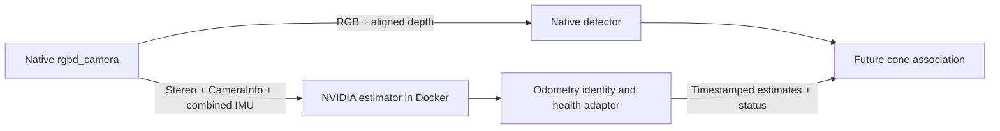

# Visual odometry integration design

Status: software implementation is consolidated on `dev`. The
[13 November integration evidence](../evidence/2026-11-13-visual-odometry/README.md)
records final-component checks. The
[15 November release qualification](../evidence/2026-11-15-vio-release-qualification/README.md)
adds the standard Docker/installer rebuild and stationary full workloads with
clock recovery. Physical calibration and moving-car acceptance remain open.
The benchmark history below informed the design; its implementation and
qualification recommendations describe the work needed at that time.

## Evidence-based starting point

See [the retained settings and findings](../visual-odometry-troubleshooting.md). OAK 360p and D455
720p were the strongest initial performance references. The 12 November follow-up
recovered OAK 720p by disabling XLink chunking: repeated Docker VIO runs delivered
30 Hz with 85–86 ms cone p95 and 100% pose-bracket coverage. The original default
transport produced roughly 305 ms cone p95 even without an estimator. Treat the
fixed profile as a demonstrated feasibility candidate. The resumed 720p RGB recording
check also maintained 30 Hz and decoded successfully, but exposed eight missing
native IMU sequence positions across both sensors. Targeted arrival/dequeue traces
then isolated host queue eviction. A 16-message queue with bounded draining
eliminated loss in two recording runs totaling five measured minutes; reverting
the change reproduced it. Port the explicit queue and processing bounds alongside
the transport setting. A separate original-configuration startup failure included
a 332 ms worker pause; the correction does not establish protection against that
long a stall. Startup/fault handling, current-component and full-workload
qualification still apply. See the report for retained evidence and limits.
D455 360p's original 124 ms VIO p95 / 278 ms maximum was reproduced and localized
downstream of camera publication, before odometry DDS output. The fixture had
declared the D455 stereo stream unrectified despite verified rectified geometry,
and used a multithreaded executor where NVIDIA's RealSense example uses a single
thread. Two corrected runs totaling eight minutes achieved about 51 ms VIO p95
and 60–61 ms maxima; the executor reversal reached 120 ms. The corrected
configuration is a feasibility candidate; retain the original failures and the
separate follow-up measurements in the report. Port the validated image convention
and explicit executor choice, then qualify the
current integration. This investigation does not establish a hard latency bound.

D455's measured profile uses native 640×480 depth/IR, aligned to native RGB at the
selected output size. Neither 720p nor 360p means native depth detail at that size.
Stereo VIO resolution stayed fixed for every test. The 30-minute stationary
memory follow-up reached a flat VIO plateau at 398.13 MiB page-map RSS during
minutes 25–30. A completed one-hour diagnostic ended at 399.48 MiB, with only
84 KiB RSS growth in its final 15 minutes and no upward allocator in-use trend
after about 20 measured minutes. Retrieval, cleanup/preservation checks and reservation release
are complete. This resolves the original stationary memory investigation for
integration planning; no upstream memory patch is indicated. Current-interface/
full-workload checks, moving-scene and fault-state memory behavior, and moving-car
validation remain open. These fixture measurements do not establish production
qualification.

## Intended behavior

Add NVIDIA Isaac ROS Visual SLAM as a local Jetson odometry capability using a
pinned Docker image. Keep camera acquisition and cone detection native. The
operator selects **Off / VO / VIO** alongside Camera and Models, then starts or
restarts perception. The selection is frozen for the run. VIO is the intended
mode after calibration and qualification; an unchanged installation remains Off
until the new capability is deliberately selected.

Use the upstream estimator, with mapping, localization and loop closure disabled.
There is no upstream fork in the initial design. Keep its ROS launch configuration
usable in a prepared native environment. Select **Docker or native at installation
time**, with Docker as the default and initial deployment reference. Record that
choice in the installed release manifest; runtime launches that selected backend.
Native/Docker is not an extra operator selector, and switching it requires stopped
maintenance and a newly prepared release. Installing one backend does not require
installing both. Native support needs its own reproducible dependency resolution
and acceptance evidence before it is advertised as supported.

Keep the abstraction small: one component launch contract, one shared ROS launch
package and parameter contract, and two concrete launch recipes. Native resolves
an installed prefix/environment; Docker resolves a pinned image and owned container.
Do not auto-detect or silently fall back between them, and do not add a proxy to the
sensor data path. The selection itself adds no per-frame work. Performance still
depends on the actual dependencies and ROS transport of each qualified installation.

The benchmark report supplies the initial measured feasibility matrix. A failed
camera/resolution combination must not become a supported preset merely because
the estimator starts. Resolution selection remains a trusted camera/deployment
profile choice; it is not a fourth runtime selector or an unbounded parameter override.

## Ownership

| Repository | Responsibility |
|---|---|
| `rgbd_camera` | Sole camera session; stereo images, intrinsics and internal extrinsics; capture clocks; bounded combined IMU; declared native/published image geometry and source identity. |
| New `visual_odometry` | Reusable ROS bringup, VO/VIO parameter presets, input validation and estimator output/health adapter; package-owned dependency and container build interface. |
| `robot_deployment` | Source and image pins, selected camera profiles, robot mounting calibration, installation, prepared run configuration, launch composition and integration evidence. |
| `robot_runtime` | Generic container ownership, lifecycle/reconciliation, stop confirmation, declared selector handling and fresh observations. No camera or NVIDIA estimation logic. |
| Future cone association | Bounded pose history, interpolation at the actual previous/current cone capture times, motion compensation and association. It is a later consumer of this contract. |

The new repository should contain `visual_odometry` and independently installable
`visual_odometry_interfaces` for atomic estimate identity and status.
Do not create a general-purpose sensor-interface repository or copy NVIDIA sources.

## Camera input contract

Preserve the existing RGB-D acquisition and capture identity contracts. Add
startup-only stereo export and the IMU mode required by VIO. Off creates neither
extra stereo export nor combined-IMU work. VO exports stereo; VIO also enables
the camera IMU. A second vendor camera driver must never be launched.

Add versioned exposure-midpoint/duration metadata to the atomic capture reference
and propagate it through `CaptureDetections` and retained overlays. The existing
OAK `acquisition_ns` convention must not silently change meaning. Keep legacy event
time distinct from explicit midpoint time, including the independent depth timing
used for pair admission. Cone association uses the explicit RGB midpoint. Unknown
exposure timing must be declared, not replaced with arrival time or an assumed offset.
This requires coordinated interface-version updates and consumer rebuilds.

Publish standard `sensor_msgs/Image` mono8 left/right images and matching
`CameraInfo` on stable namespaced topics. Each pair carries the real image capture
time, using the exposure midpoint consistently. Publish the actual transformed
intrinsics and distortion convention for the delivered grid. Never substitute
arrival time, resize without updating intrinsics, or silently change frame rate.
Retain per-stream sequence, source generation, clock domain and calibration
identity in bounded camera metadata/diagnostics. Correlate calibration with the
active session, rather than assuming that a camera model name identifies calibration.

Use the measured stereo profiles initially: OAK 640×400 and D455 640×480 at 30 Hz.
For the tested D455 stream, SDK calibration has matching intrinsics, zero
distortion, identity relative rotation and a horizontal baseline; it satisfies
the rectified stereo convention. Use `rectified_images=true` for that validated
profile. Check the delivered calibration at startup; do not infer this convention
for every device/profile, or apply it to the OAK raw stereo stream automatically.
Specify RGB, native depth and published aligned depth dimensions separately. D455
profiles must admit concurrent depth/IR operation, not merely pass enumeration.
For OAK, preserve aspect ratio for 16:9 outputs and validate the delivered SDK
geometry. Keep all buffers and queues bounded, with observable drops/rejections.

Form combined `sensor_msgs/Imu` samples at gyro timestamps by interpolating
accelerometer samples that bracket them. Retain the gyro timestamp; never
extrapolate missing acceleration. Bound queue length and interpolation gap,
discard invalid samples with counters, and expire readiness on stale input.
Report orientation as unavailable. Preserve the provider's axis/origin convention,
SI units and measured camera–IMU transform. Noise parameters must name their
source and units; vendor defaults are not evidence of calibration on this car.

The camera owns internal sensor transforms; deployment owns the measured mount
to the robot. Remove duplicate TF publishers when extending the existing RGB
optical-frame tree. Verify gravity, positive rotations and transform direction
on each actual device before declaring VIO suitable for motion compensation.

## Estimator, identity and health

Remap the camera topics directly into NVIDIA's component; avoid image relay nodes
that copy large buffers without a concrete need. Use the same tested raw/rectified
image convention and explicit QoS. Keep parameter presets small and versioned.
Use the explicitly selected single-threaded `component_container` for the D455
candidate, matching NVIDIA's pinned RealSense example and the tail investigation.
Its image/IMU callbacks already share a mutually exclusive callback group. Record
the executor and effective image convention in run identity; remeasure other
presets and the final component composition rather than extrapolating this result.

Expose standard `nav_msgs/Odometry` for ordinary ROS consumers and an authoritative
`Estimate` message for capture association. The latter contains Odometry, camera
source/generation, estimator generation, sequence, capture time/clock domain and
calibration/configuration identity. Separate status and Odometry topics cannot
guarantee an atomic generation join across a reset. Do not encode session IDs in
TF frame names. This is a specific identity gap, not a generic message framework.

A small adapter reports initializing/tracking/lost/error and last valid input/output
times. Its health depends on fresh sensor data, fresh odometry and the upstream
status, not process liveness or log parsing. Isaac ROS 4.6's `VisualSlamStatus`
exposes `vo_state` (unknown/success/failed) and processing times; it does not by
itself establish fused-VIO accuracy or calibrated confidence. Document how that
limited signal maps to the public state. Initial acceptance must not treat stale
poses or unqualified inertial-only continuation as valid visual tracking.

Camera restart, estimator restart/reset, calibration change and loss/recovery that
may invalidate continuity start a new association epoch. A consumer clears old
history and pending associations at that boundary. No automatic camera reconnect
or estimator reset silently bridges pose histories. Define covariance honestly;
unknown uncertainty is not zero uncertainty.

Choose exactly one publisher for `odom → base_link`. Enable that transform only
with an approved measured mount; otherwise expose a correctly named camera-body
pose. The repository's illustrative robot dimensions do not qualify a vehicle-frame
pose. Mapping TF remains disabled. Use output capture stamps, never publication
time, for motion compensation.

## Installation backend and container lifecycle

The new package owns its dependency/build interface. Deployment selects the exact
source commit, base digest, NVIDIA package version and resulting image digest,
records the dependency manifest, and verifies compatibility with host JetPack,
CUDA and ROS. Install/build during maintenance; launch uses an already present
verified image and never downloads or resolves a tag. Host OpenCV/CUDA packages
must not be replaced as an incidental effect of installing the estimator.

For a native selection, record the exact package/prefix and dependency identities
instead of an image digest, validate compatibility with existing host dependencies,
and use the ordinary supervised native-process path. Common input/output, health,
mode and preparation contracts remain identical. Keep the native installer small;
reject an incompatible host rather than modifying shared OpenCV/CUDA implicitly.
Backend-specific cleanup remains explicit: native process/cgroup cleanup for native,
verified process plus container cleanup for Docker.

Use the tested host ROS communication settings as the initial reference. Pass
only trusted prepared parameters and required read-only mounts. The estimator
does not need camera access or the Docker socket. Any reduction or change in the
tested IPC/network/PID configuration requires a communication and lifecycle check.

Stopping the foreground `docker run` client is insufficient evidence that the
container stopped. Add narrowly scoped Docker resource ownership to runtime.
Derive an exact container name and labels from the runtime namespace and run ID,
persist the intended identity before creation, and record/verify the returned ID.
Observe both the native process cgroup and the owned container when deciding
whether a perception run is empty. An active, paused or restarting container still
counts as owned work. A daemon outage is unknown state, not successful cleanup.

Normal Stop sends a graceful signal to the actual container and waits for exit.
Escalation follows the existing explicit stop policy and targets only an identity
whose ownership has been verified. A failed or uncertain stop prevents replacement.
Runtime recovery reconciles retained containers and native processes without
automatically starting workloads. Handle cancellation or launcher death during
the container-create race; deterministic run identity must allow safe reconciliation.
Keep blocking Docker calls off the serialized command-policy loop.

The deployment launcher groups native camera/detector and the Docker estimator
under one perception run. Starting the native camera follows validation of model,
estimator image and frozen configuration. If required odometry startup fails,
clean up the candidate run and report failure, rather than showing VIO enabled
while only detection is running. Tracking loss during an active run is a separate
health observation and must remain visible to consumers.

## Selection and preparation

The current runtime supports three independent selectors but only eight launch
modes; camera × model already consumes eight. Adding Off/VO/VIO requires up to
24 trusted combinations. Extend the bounded mode limit coherently to 32 across
profile, ROS-topic and AV-source validation and public clients. Retain three
selectors and finite installed combinations; do not add arbitrary runtime overrides.
Only emit combinations supported by the selected camera profile and qualification.

Preparation freezes the installed backend, mode, source/image or native-prefix
identities, calibration/mount identity,
topic/frame mappings and effective parameters before stopping an old run. Invalid
configuration leaves the current run intact. The launcher consumes only that
accepted snapshot. New profile fields/version compatibility must fail clearly on
an older runtime; install matching runtime/deployment revisions together.

## Concrete integration decisions

- CaptureReference schema 2 adds explicit midpoint/duration in signed monotonic
  nanoseconds (zero means unknown), preserving acquisition_ns and standard RGB-D
  headers. Frame and CaptureDetections retain independent depth midpoint/duration.
  Detector, overlay and recorder consumers rebuild together.
- StereoCapture atomically names both images, their real midpoint stamps, session
  clock mapping, calibration and raw/rectified convention. Pair skew is at most
  1 ms. Images remain on standard topics; the sidecar carries no pixel copies.
- The pinned Isaac ROS 4.6 wrapper stamps Odometry and VisualSlamStatus with the
  maximum input-image timestamp. Pin override_publishing_stamp=false,
  min_num_images=2 and sync_matching_threshold_ms=1.0. The output adapter requires
  an exact three-way metadata/odometry/success-status join, independent of DDS
  arrival order, with bounded retention and source freshness checks.
- The raw upstream reset service has no reset identity. Supported resets are
  supervised run restarts. Tracking loss, stale input/output and source changes
  invalidate pending joins and continuity; status is not calibrated confidence.
- Allow 90 seconds for the first fresh matched estimate after candidate start.
  Failure before readiness stops the entire candidate. Later tracking loss is a
  visible health event; it never silently restarts the camera or estimator.
- Off keeps legacy capture defaults. The initial explicit OAK VIO preset requests
  200 Hz IMU and fixed mono exposure 20000 us / ISO 800, matching the fixture.
- Runtime persists exact Docker ownership intent before dispatch, and verified
  full ID before attaching the launcher. An uncertain create is retained as
  uncertain even if one inspection finds no name: a delayed request may commit.
  Recovery needs a matching object or an explicit daemon/request fencing procedure.
- Browser Restart uses the manager's atomic restart operation, which freezes the
  candidate before stopping the existing run. Accepted operations survive client
  disconnect; cancellation before dispatch differs from stopping a created run.

## Acceptance boundaries

Re-run the matched performance comparison using the final interfaces and adapter,
including current `CaptureDetections`, rather than treating the temporary legacy
fixture as production acceptance. Preserve the original numerical gates and explain
any breach. Then measure the complete intended workload, including dual detectors,
video and recording if they are to coexist. Measure startup, shutdown, cancellation,
manager recovery and failure paths with real owned Docker containers.

Before moving-car use, establish actual mounting/IMU calibration, timestamp bounds,
rotation/translation behavior, drift, tracking loss/reset handling, vibration/exposure
robustness and cone-detection quality at the selected resolution. The current
stationary feasibility test does not satisfy those gates. Cone association and
vehicle control remain separate implementation and acceptance work.
